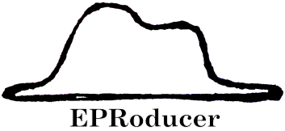

<p align="center">
  
</p>

**EPRoducer** is a set of tools to find which radicals explain an EPR
(Electron Paramagnetic Resonance) spectrum. It computes the g-values and
hyperfine couplings of radical candidates with ORCA, predicts their EPR spectra
with EasySpin, and fits the experimental spectrum with them, giving the
proportion of each candidate in the sample. All the tools are available from
the terminal as `eproducer <function>`.

## Installation

```bash
git clone https://github.com/Sucerquia/PlottingTool.git
pip install ./PlottingTool
cd EPRoducer
pip install -e .
```

The calculations also need ORCA, MATLAB with EasySpin, and VMD.

## Documentation

The documentation is available at https://graeter-group.github.io/EPRoducer/.
You can also run `eproducer doc` to open a local copy in your web browser, or
`eproducer -h` to list all the tools.
