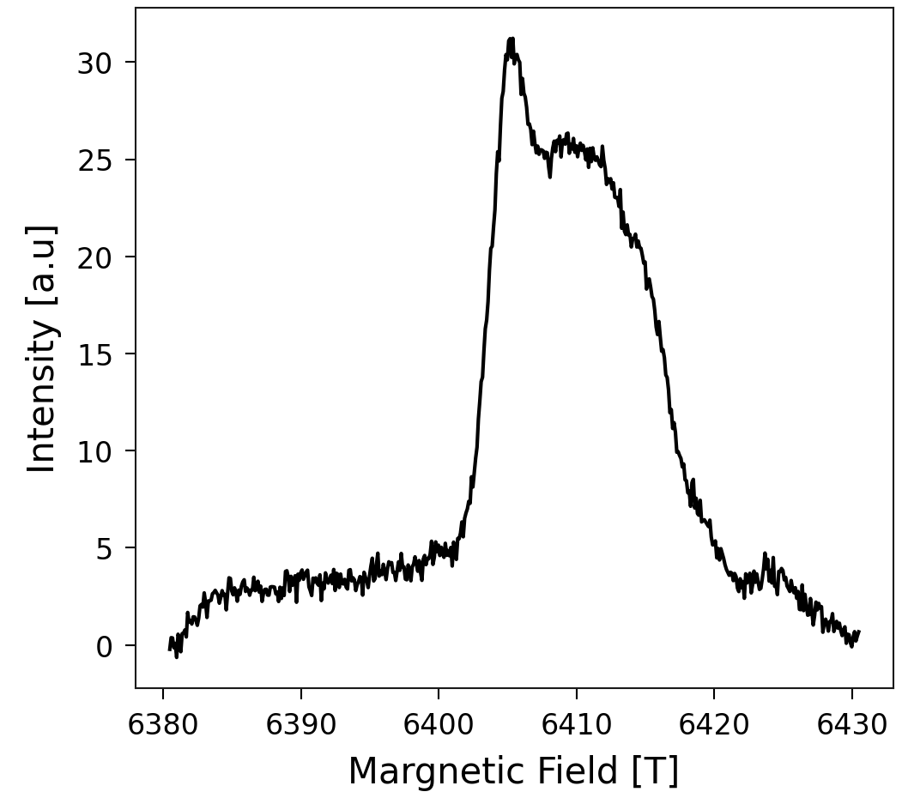
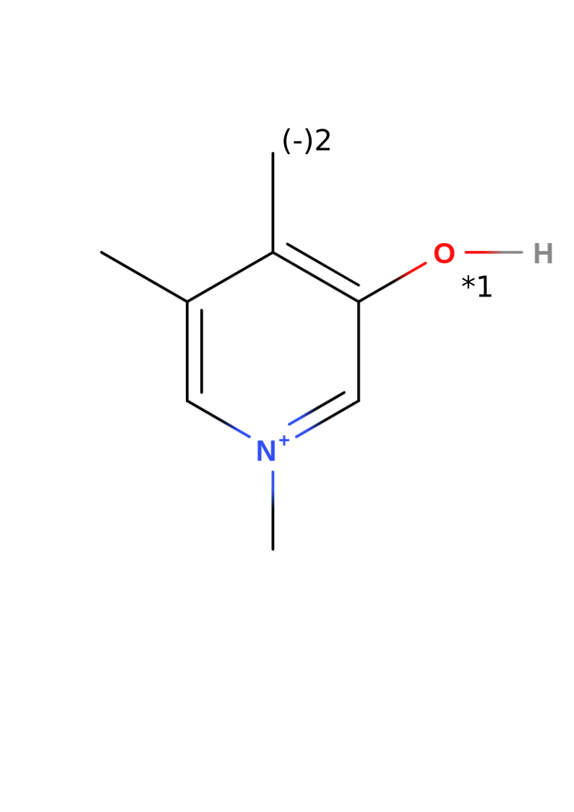
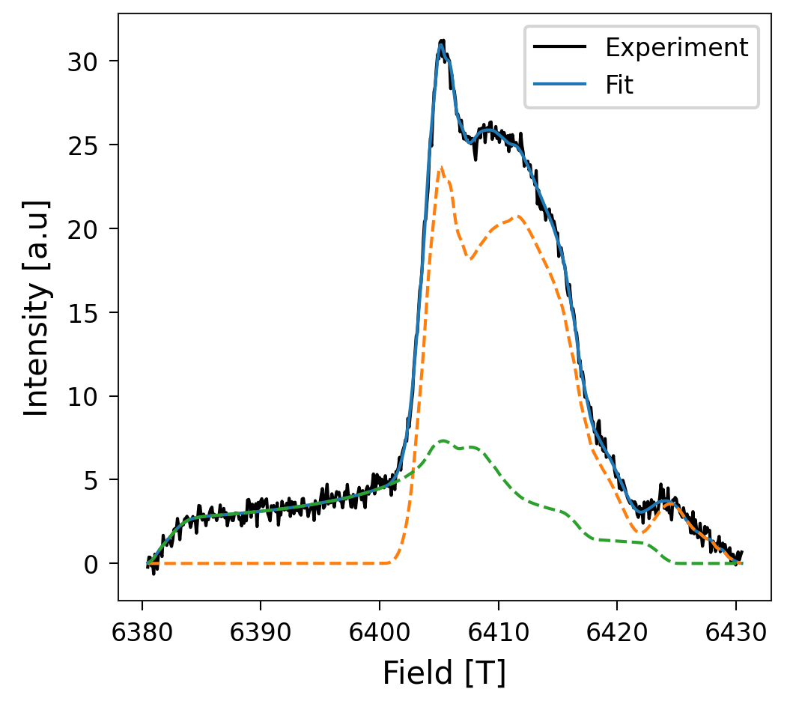

Theoretical EPR spectrum
------------------------

.. attention::

    To use the tools of EPRoducer that are part of this tutorial, be sure that
    ORCA, MATLAB (with EasySpin) and VMD are well set up. Check
    :ref:`orca-setup` for more information.

.. admonition:: For the impatient

    This tutorial builds a whole project. If you only want to compute the
    g-values of a molecule with a radical that you already know, go directly to
    :ref:`Compute the g-values <gval-workflow-tutorial>`.

Suppose that you have an EPR absorption spectrum that you got from a sample of
collagen that looks like this:

In this tutorial, you will learn how to discover which radical species this
spectrum comes from, using **EPRoducer**. This process is usually done by
finding, by trial-and-error, the g-values that best fit the experiment. Our
procedure, in contrast, consists of computing the spectra of some candidates
that you expect in your sample and finding which ones fit the spectrum. With
the final fit, you obtain the concentration of each radical species in your
sample. In this case, we are going to assume a rupture of trivalent
crosslinks, which were shown to be sacrificial bonds by
`Rennekamp, et al., 2023 <https://www.nature.com/articles/s41467-023-37726-z>`_.

System
======

Consider the radicals in a broken trivalent crosslink, which corresponds to the
following molecule:

Note that the structure of this example without radicals has a total charge of
+1. The numbers 1 and 2 in the image represent the two candidates that we are
going to consider in this tutorial. Candidate 1 results from taking out the
hydrogen bonded to the oxygen and increasing the multiplicity to 2 (radical).
Candidate 2 results from deprotonating the methyl group of the first
candidate, which leads to a total charge of zero. Since the DFT calculation
determines how the charges are distributed, the second candidate can also be
seen as a radical in the methyl group and a negative charge in the oxygen.

Starting a new project
======================

To use all the advantages of EPRoducer, the files must follow a specific folder
structure, which you will build step by step during this tutorial. The general
structure looks like this:

.. code-block:: none

    <project>/
    ├── experiments/
    └── <molecule>/
        ├── opt/
        └── <i>-<radical name>/

Here, "<project>" is the name of the whole project, "<molecule>" is the
molecule that you use as a base to create the radical candidates, and
"<i>-<radical name>" is the directory of the i-th radical candidate, where
"<i>" is a number and "<radical name>" a name of your choice. For this
tutorial, the tree looks like this:

.. code-block:: none

    CollagenEPR/
    ├── experiments/
    └── PYD/
        ├── opt/
        ├── 1-OxygenCharged/
        └── 2-OxygenNeutral/

Your task now is to create this folder structure:

.. code-block:: bash

    mkdir CollagenEPR
    mkdir CollagenEPR/experiments
    mkdir CollagenEPR/PYD
    mkdir CollagenEPR/PYD/opt
    mkdir CollagenEPR/PYD/1-OxygenCharged
    mkdir CollagenEPR/PYD/2-OxygenNeutral

Now save your
`absorption spectrum <https://raw.githubusercontent.com/Sucerquia/collagenEPR/refs/heads/main/experiments/field_intensity2.dat>`_
in the "experiments" directory as :code:`CollagenEPR/experiments/field_intensity.dat`.
You can save as many measurements as you have. They should be .dat files with
two columns: field and intensity.

Create a model
==============

To compute radicals, you need an XYZ file with the molecular coordinates. You
can build it with your favorite tool. We recommend
`https://molview.org <https://molview.org/>`_, which allows you to build your
molecule from the structural formula and download its coordinates.

.. note::

    To transform the .mol file downloaded from MolView into an .xyz file, use

    .. code-block:: bash

        obabel model.mol -O CollagenEPR/PYD/opt/model.xyz

You might want to save an image of your molecular structure, because at the
end we are going to summarize the results in a clear and easy way. That image
should also show the labels of the candidates, as in the image above. Save it
as :code:`CollagenEPR/PYD/molecule.png`.

Optimize the model
==================

Depending on how you built your molecule, the model could be far from a stable
configuration. Be aware that the g-values of the candidates have to be
computed with optimized configurations. Optimizing the initial model can speed
up the subsequent optimizations of the radicals derived from it, which pays off
when you have several candidates. It is optional, though, because each radical
is optimized again when its g-values are computed. If you already have a good
structure, or if you want to skip this step, copy your model to

.. code-block:: bash

    cp CollagenEPR/PYD/opt/model.xyz CollagenEPR/PYD/opt/model_opt.xyz

and continue to the next section. Otherwise, optimize your structure with
EPRoducer:

.. code-block:: bash

    cd CollagenEPR/PYD/opt
    $(eproducer gval_workflow -path) -c 1 -m 1 -e -v

The flag -e skips the computation of the g-values and the hyperfine couplings
(HFC), which would not make sense here because this molecule has no radical.
The optimized structure is saved in :code:`model_opt.xyz`. Use
:code:`eproducer gval_workflow -h` to check the role of the other flags.

.. _comment-slurm-bash-tutorial:

.. note::

    gval_workflow is a bash script with :code:`#SBATCH` options for the SLURM
    queue system, so you can also submit it to an HPC cluster with
    :code:`sbatch $(eproducer gval_workflow -path) ...`. To modify those options
    or add the ones of your queue system, make a copy of the script with
    :code:`cp $(eproducer gval_workflow -path) ./<name_of_preference>.sh` and
    submit your copy. You can also use it to understand and modify this code
    according to your style. If you improve the project, don't hesitate to
    contribute your changes to EPRoducer.

Create radical models
=====================

Use the optimized model to create the radical candidates. You can do that by
removing the hydrogen atom that caps each radical site. One way to do that is
viewing your molecule with your favorite visualization tool (VMol, PyMol,
VMD...) to check the index of the atom and remove it. Save the xyz file of each
modified molecule in a new directory called :code:`<i>-<radical name>`. In this
case, we create the radical candidates from
:code:`CollagenEPR/PYD/opt/model_opt.xyz`: candidate 1 is obtained by removing
the hydrogen 6, and candidate 2 by removing the hydrogens 6 and 16 (indices
starting from 1). Considering that the xyz format includes two heading lines (a
first line with the number of atoms and a second line for comments), the 6th
and 16th atoms correspond to the 8th and 18th lines, respectively. Then, from
the folder "CollagenEPR/PYD", we execute the following commands to remove those
atoms from the optimized molecule and save the outcome in the proper directory:

.. code-block:: bash

    sed -E "1s/.*/21/ ; 8d" opt/model_opt.xyz > 1-OxygenCharged/model.xyz
    sed -E "1s/.*/20/ ; 18d ; 8d" opt/model_opt.xyz > 2-OxygenNeutral/model.xyz

The resulting molecules should look like the following figure (candidate 1 on
the left, candidate 2 on the right):

.. raw:: html

    

        

            
        

        

            
        

    

.. _gval-workflow-tutorial:

Compute the g-values
====================

Once you have the file :code:`<i>-<radical name>/model.xyz` of each radical,
run

.. code-block:: bash

    cd 1-OxygenCharged
    $(eproducer gval_workflow -path) -c 1 -f 'g1,4d2' -v
    cd ../2-OxygenNeutral
    $(eproducer gval_workflow -path) -c 0 -f 'g1,4,6d2' -v

The flag -f indicates which atoms should be included in the hyperfine
calculation. If its argument starts with g,
:func:`eproducer.g_valsetup.HFC_relevantA` is used to guess the H, O and N atoms
around the possible radical locations. For example, :code:`'g1,4d2'` means:
guess (:code:`g`) the relevant atoms around the atoms 1 and 4, up to two bonds
away (:code:`d2`). The indices start from 1 and refer to the :code:`model.xyz`
file of each candidate, so they can differ from the indices in the original
molecule because some hydrogens were removed. In this case, for the HFC, we
included all the atoms selected by HFC_relevantA around the nitrogen (index 1),
the oxygen (index 4) and, in candidate 2, the carbon that can be charged
(index 6). For more information about the guess function and the other flags,
use :code:`eproducer gval_workflow -h`. This workflow does what is explained in
the
`ORCA tutorial <https://www.faccts.de/docs/orca/5.0/tutorials/spec/EPR.html>`_
and in
`Zhe Wang's tutorial <https://wongzit.github.io/epr-prediction-with-orca-program/#2-hyperfile-coupling-constant>`_.
In each candidate directory, it creates :code:`model_opt.xyz` (optimized
radical), :code:`model_epr.out` (g-values and HFC) and :code:`model_freq.out`
(frequencies).

.. note::

    gval_workflow is a bash script that you can modify. See
    :ref:`last comment <comment-slurm-bash-tutorial>` for more details.

.. tip::

    gval_workflow also computes frequencies by default, which includes the
    computation of thermal properties. In particular, it computes the enthalpy
    of the molecule, which is useful to compute bond dissociation enthalpies
    (BDEs). If you want to skip this part, use the flag -b.

Compute the spectra
===================

With the g-values and the hyperfine couplings, compute the theoretical
spectrum of each candidate with `EasySpin <https://www.easyspin.org/>`_, using
the field range of your experiment:

.. code-block:: bash

    cd 1-OxygenCharged
    $(eproducer extract_EPRspec -path) -e ../../experiments/field_intensity.dat -O model_epr.out -f
    cd ../2-OxygenNeutral
    $(eproducer extract_EPRspec -path) -e ../../experiments/field_intensity.dat -O model_epr.out -f

The flag -f includes the hyperfine corrections, which requires a lot of memory.
The spectrum is saved in :code:`spectrum_wo_hyFiCorr.dat`, the file that the
next steps look for. Despite its name ("without hyperfine correction"), the
file keeps this name also with -f. The default microwave frequency
(179.813 GHz) corresponds to G-band experiments; use the flag -m for other
bands. Check :code:`eproducer extract_EPRspec -h` for the other flags.

Postprocessing
==============

Once your calculations are complete, you can use :code:`eproducer gval_postpro` to:

- Render each model in a file called opt.png
- Plot the g-values of all the candidates in a file called gvalues.png
- Create a table of the g-values in gvalues_table.md
- Create a file called vmd_image.md in each one of the candidate directories,
  with the comparison of its spectrum with each experiment.

Move to the project folder (:code:`CollagenEPR`) and run

.. code-block:: bash

    $(eproducer gval_postpro -path) -c PYD/ -e ../../experiments/field_intensity.dat -O model_epr.out

The paths given with -e are relative to the candidate directories
(:code:`PYD/<i>-<radical name>/`), where the spectra are compared.

Summarize your results
======================

With the information obtained from the postprocessing, you can write a proper
README.md file to summarize your results. :code:`eproducer gvals_template` makes
this step quite easy. Copy the template to your project folder with
:code:`cp $(eproducer gvals_template -path) ./write_readme.sh`. This template
creates the README. To adapt it to your own project, modify the blocks
delimited by :code:`EOF` with the corresponding information. Also, change the
parts that have :code:`<replace:`. Then, run it and redirect its output to
README.md. In this case, we do

.. code-block:: bash

    cp $(eproducer gvals_template -path) ./write_readme.sh
    sed -i "s/<replace: name of your candidates>/PYD/g" write_readme.sh
    sed -i "s/<replace: experiment>/field_intensity/g" write_readme.sh
    sed -i "s/<replace: fitting name>/fit2exper1/g" write_readme.sh
    ./write_readme.sh > README.md

and this creates a markdown file with the summary of all the results. Render
your project with your tool of preference. GitHub and GitLab render these files
automatically. Your whole project should now look like the repository
`github.com/Sucerquia/collagenEPR <https://github.com/Sucerquia/collagenEPR>`_.

.. tip::

    You can transform your README.md into a webpage using `GitHub Pages
    <https://pages.github.com/>`_.

Fit
===

At the end of the summary, there is an image of the best possible fit with
your candidates. In this case, it should look like this

Great fit, isn't it?! Now the question is how much of the spectrum comes from
each candidate. The answer to this question is in the table at the end of the
README. The outcome in this case is

.. list-table::
   :header-rows: 1
   :widths: 30 30
   :align: center

   * - System
     - Percentage (%)
   * - PYD/2-OxygenNeutral
     - 70.04
   * - PYD/1-OxygenCharged
     - 29.96

You got a perfect description of your EPR spectrum with the candidates you took
into account! Now, you can use it with your own experimental data and radical
candidates.
